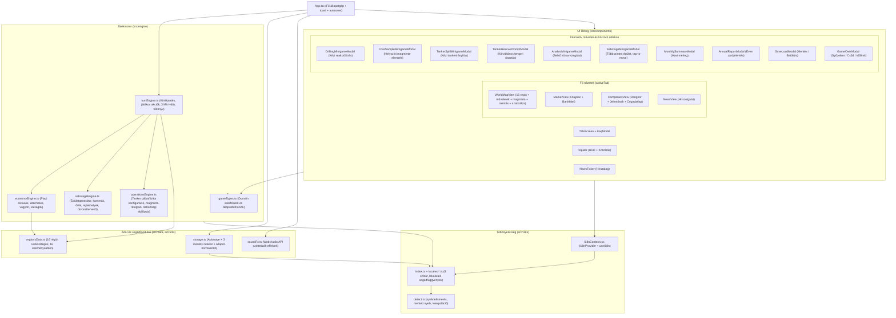
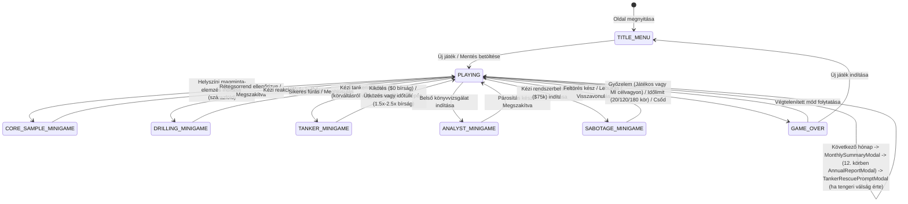
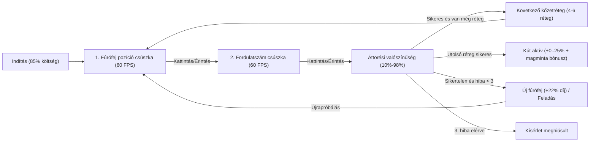
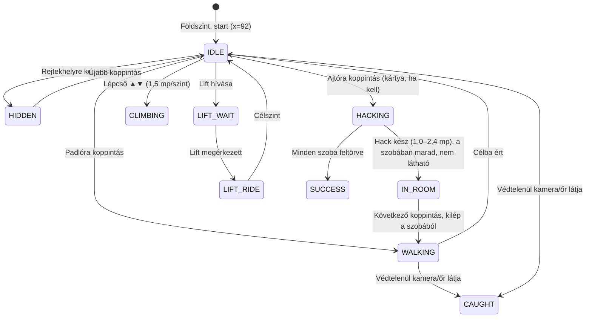

# Crude Tycoon — Teljes Projekt Dokumentáció (`artifact.md`)

> **Karbantartási szabály:** Ez a dokumentum a teljes **Crude Tycoon** alkalmazás élő architekturális és játékmeneti leírása (a projekt része a `doc/artifact.md` fájlban és az Artifacts nézetben egyaránt). **Minden új funkció, egyensúly-módosítás, interaktív művelet vagy UI-változtatás után kötelező frissíteni!**

---

## 1. Projekt áttekintés és technológiai stack

A **Crude Tycoon** egy 100%-ban kliensoldali, körökre osztott, az 1990-es évek klasszikus olajipari gazdasági stratégiái által ihletett szimulációs játék, **8 nyelvű, élőben váltható felülettel** (`en`, `hu`, `de`, `es`, `fr`, `pt`, `pl`, `zh`; részletek a **8. szakaszban**).

- **Nyelvi konvenciók:** A felhasználói felület és a játékon belüli tartalom (régiók, hírek, jelentések) mind a 8 nyelven elérhető, az eredeti alapnyelv a magyar; ez a dokumentáció magyar nyelvű. A forráskód, fájlnév, típusdefiníció és komment angol nyelvű. Az alábbi szövegek és elnevezések a magyar nyelvű felületet idézik. A felhasználói felületen nem használunk „minijáték” kifejezést — minden interaktív folyamat és külső alternatívája természetes iparági elnevezéssel szerepel (*Kézi reakciófúrás* vs *Kivitelezői fúrás*, *Belső könyvvizsgálat* vs *Külső elemző bérlése*, *Kézi rendszerbehatolás* vs *Külső hekker-csoport*, *Kézi tankerirányítás* vs *Tengeri mentőszolgálat*, *Helyszíni magminta-elemzés* vs *Külső geológiai intézet*).
- **Technológiai verem:**
  - **Keretrendszer:** React 19 + TypeScript (`tsc --noEmit`) + Vite 8 (`port 3000`)
  - **Stílus:** Tailwind CSS v4 (`@tailwindcss/vite`), sötét ipari-terminál paletta (`#12161B`, `#1B222B`, `#E59A24` borostyán, `#44B872` terminálzöld, `#D94436` riasztóvörös, `#38BDF8` tengeri cián), `font-mono tabular-nums` számformázás
  - **Vizualizáció és ikonok:** Egyedi interaktív SVG világtérkép, 2D épület-keresztmetszet és 60 FPS HTML5 Canvas tengeri navigáció, `recharts` spot árfolyam- és vagyongrafikonok, `lucide-react` ikonok
  - **Hangmotor:** Beépített Web Audio API szintetizátor (`soundFx.ts`), külső hangfájlok nélkül
  - **Perzisztencia:** Böngésző `localStorage` alapú automatikus mentés és 3 manuális mentési rekesz (`storage.ts`), valamint a választott nyelv mentése (`crude_tycoon_lang_v1`)
  - **Többnyelvűség:** Külső függőség nélküli, típusbiztos szótárrendszer React kontextussal (`src/i18n`)

---

## 2. Rendszerarchitektúra és komponens-diagramok

### 2.1 Rétegzett alkalmazás-architektúra

### 2.2 Képernyő-állapotgép (`GameScreenState`) és körzárási sorrend

> **Megjegyzés:** a `GameScreenState` típus tartalmaz egy `PAUSED` állapotot is, de az jelenleg nincs használatban (fenntartott érték), ezért nem szerepel a diagramon.

### 2.3 Fájlstruktúra

| Mappa / Fájl | Szerepkör |
| --- | --- |
| `src/App.tsx` | Gyökér komponens, eseménykezelők, nézet- és modál-orkesztráció (beleértve a körváltásos `TankerRescuePromptModal`-t), toast értesítések, autosave hívások |
| `src/engine/gameTypes.ts` | Minden TypeScript típus (`GameState`, `RegionStatic`, `RegionRuntimeState`, `Company`, `MonthlyTurnSummary`, `SabotageMinigameSession`, `TankerMinigameSession`, `CoreSampleMinigameSession`, `PendingTankerRescuePrompt`) |
| `src/engine/turnEngine.ts` | Játékállapot inicializálása, vásárlási/fúrási/magminta/mentési/eladási/hitel/elemzői/szabotázs akciók, 3 MI-rivális logikája, havi körzárás |
| `src/engine/economyEngine.ts` | Havi kút-kitermelés (válság- és hekkelésszorzókkal), cégvagyon-számítás, spot árfolyam dinamika (`$28–$135`), geopolitikai és éghajlati válságok |
| `src/engine/sabotageEngine.ts` | Többszintes lopakodó épületgenerátor (`3–5` szint, `3–5` szoba), kamera- és őrkinematika, rejtekhely-védelem, észlelés, lift/lépcső útvonaltervezés |
| `src/engine/operationsEngine.ts` | Tanker navigációs pálya- és zátonygenerátor (`buildTankerNavigationSession`), nehézségfüggő tengeri mentési jutalmak/bírságok (`getTankerRescueConfig`), kőzetkémiai rétegszámoló és elemzői bónuszok (`buildCoreSampleSession`, `evaluateCoreSampleOrder`, `getCoreSampleConfig`) |
| `src/data/regionsData.ts` | A 16 olajtermelő régió statikus adatai, 6 kőzetréteg-típus, 16 globális/regionális eseménysablon |
| `src/utils/storage.ts` | `localStorage` kulcskezelés, visszafelé kompatibilis mentés-normalizálás (aktív műveleti képernyők biztonságos szűrése) |
| `src/i18n/index.ts` | `TRANSLATIONS` térkép, `getDict`, lokalizált szám-/deviza-/hordó-/dátumformázók, régió-, esemény-, hír-, rétegtani, MI-mottó és játékvége-összegző lokalizáló függvények |
| `src/i18n/types.ts` | `SupportedLanguage`, `LANGUAGE_OPTIONS` (kód, natív név, `localeTag`) és a `TranslationSchema` interfész (a 8 szótár közös, fordítási időben ellenőrzött sémája) |
| `src/i18n/detect.ts` | Böngészőnyelv-felismerés, mentett nyelv (`crude_tycoon_lang_v1`), aktív nyelv és feliratkozás, `interpolate` helyőrző-behelyettesítő |
| `src/i18n/I18nContext.tsx` | `I18nProvider` és `useI18n` hook; `html lang`, oldalcím és meta leírás szinkronizálása |
| `src/i18n/locales/*.ts` | A 8 nyelvi szótár: `en`, `hu`, `de`, `es`, `fr`, `pt`, `pl`, `zh` |
| `src/utils/soundFx.ts` | Procedurális hanghatások (kattintás, fúró, áttörés, kártya, lépés, terminál, riasztó, hajótest-ütközés, kikötés, laborcsere/siker/hiba, körzárás, kassza) |
| `src/components/*.tsx` | 19 moduláris UI és műveleti komponens (beleértve a `LanguageSelector` nyelvválasztót) |

---

## 3. Fő játékmechanikák és nézetek (Feature lista)

### 3.1 Kezdőképernyő és nehézségi szintek (`TitleScreen`, `FaqModal`)
A játék **1994. januárban** indul, nehézségi szinttől függő üzleti időtávval (**20 / 120 / 180 hónap** — de győzelem/időlimit után végtelenített módban is folytatható). **Új győzelmi/vereségi szabály:** ha bármelyik MI-rivális a játékost megelőzve éri el a `victoryNetWorthTarget` célvagyont, a játék azonnal `VICTORY_TARGET` eredménnyel véget ér a rivális győzelmével. Három MI-vállalat versenyez a játékossal:
- **Borealis Energia Zrt.** (`CONSERVATIVE_SPECULATOR`) — óvatos tartalékoló és árciklus-követő
- **Vektor Nyersanyag Rt.** (`AGGRESSIVE_EXPANSIONIST`) — gyors koncesszió-felvásárló és terjeszkedő
- **Meridián Kitermelő Kft.** (`CARTEL_BALANCER`) — kiegyensúlyozott kínálat- és készletkezelő

| Nehézségi szint | Induló készpénz (Játékos) | Induló készpénz (MI) | Győzelmi célvagyon | Időlimit (`maxTurns`) | Kivitelezői fúrás szorzó | Évi min. régiós válság |
| --- | --- | --- | --- | --- | --- | --- |
| **Könnyű (`EASY`)** | `$1 950 000` | `$2 150 000` | `$8 400 000` | `20 hónap` | `106%` | `2` / év |
| **Normál (`STANDARD`)** | `$1 950 000` | `$1 750 000` | `$126 000 000` | `120 hónap` (`10 év`) | `114%` | `3` / év |
| **Nehéz (`HARD`)** | `$1 550 000` | `$1 750 000` | `$220 000 000` | `180 hónap` (`15 év`) | `195%` | `4` / év |

- **Csődfeltétel:** Ha a játékos készpénze `-creditLimit * 0.5` (`-$1 000 000`) alá csökken, csődeljárással véget ér a játék.

### 3.2 Világtérkép és Régió-menedzsment (`WorldMapView`)
- **16 globális olajmező:** Szárazföldi és tengeri (`offshore`) blokkok eltérő koncessziós árral, fúrási nehézséggel (`1–5`), tartalékkal, logisztikai árszorzóval és politikai stabilitással.
- **Régiós műveletek:**
  - Koncesszió megvásárlása szabad régiókban.
  - Tárolótartályok építése (kapacitás bővítése; teli tartály esetén a kutak visszafogásra kerülnek).
  - **Geológiai magminta-elővizsgálat** (csak szárazföldi régiókban, új fúrás előtt): **Helyszíni magminta-elemzés** vagy emelt díjas **Külső geológiai intézet**.
  - Olajkutak telepítése: **Kivitelezői fúrás** (`106% / 114% / 195%` ár, azonnali) vagy **Kézi reakciófúrás** (`85%` induló ár, akár `+25%` + magminta-bónusz hozam).
  - Kútvezérlés: Egyedi termelési kvóta (`0%–100%`) és aktiválás/szüneteltetés.
  - Helyi nyersolaj értékesítése (`spotPrice * logisticsMultiplier * crisisPriceMultiplier`).
- **Válságjelző és Tengeri Katasztrófaelhárítás a térképen:** Az aktív regionális válsággal sújtott **saját koncessziók** erős vizuális válságjelző kiemelést kapnak a térképen és a kút-kártyákon; ha tengeri vihar, hurrikán vagy tartályhajó-baleset sújtja a régiót és még nem történt mentési beavatkozás, közvetlenül a térképről is indítható a **Kézi tankerirányítás** vagy a **Tengeri mentőszolgálat**.
- **Koncessziós Szabotázs / Hekkelés panel:** Minden már birtokolt (saját vagy rivális) koncesszión elérhető, lásd a **4.3** és **5.** pontokat.

### 3.3 Olajpiac és Bankhitel (`MarketView`)
- **Piaci ciklusok:** Gyors, 1–2 körönként forduló ciklusfázisok: `BOOM` (konjunktúra), `STABLE` (átmeneti egyensúly, közvetlenül `BOOM`/`GLUT` felé lép tovább), `GLUT` (túlkínálat), `CRISIS` (ellátási zavar), gyors szinuszos/harmónikus makrohullámmal.
- **Dinamikus spot ár:** `$28 – $135 / hordó` tartományban mozog, lapos/változatlan körök nélkül — minden egyes körben garantált **`$4,80 – $16,50 / hordó`** közötti érezhető kilengéssel és éles határeffect-visszapattanással a szélsőértékeknél (`≤ $34` vagy `≥ $129`), valós időben követhető interaktív árfolyamgrafikonon.
- **Készletkezelés:** Régiónkénti vagy egykattintásos teljes portfóliós eladás (`Összes olaj eladása`).
- **Banki finanszírozás:** `$2 000 000` hitelkeret, havi **`1,5%`** automatikus kamatteherrel, rugalmas hitelfelvétellel és tőketörlesztéssel.

### 3.4 Vállalatok, Könyvvizsgálat és Jelentések (`CompaniesView`, `AnnualReportModal`)
- **Rangsor nézet:** A 4 vállalat nyilvános adatai (legutóbbi hivatalos negyedéves/éves mérleg szerint).
- **Jelentések archívum:** Negyedéves (minden 3. körben) és Éves zárójelentések (minden 12. körben).
- **Cégadatlap (`DOSSIER`):** Egy kiválasztott rivális részletes profilja. Alapértelmezetten az élő készletek és aktuális pénzügyi adatok rejtve maradnak — kizárólag a Cégadatlapon található **Belső könyvvizsgálat** vagy **Külső elemző bérlése (`$70 000 / $95 000 / $150 000`, `3 hó`)** gombokkal nyithatók meg. *(A Világtérkép és a Rangsor táblázat szándékosan nem tartalmaz könyvvizsgálati gombokat.)*

### 3.5 Hírszolgálat és Hírszalag (`NewsView`, `NewsTicker`)
- **16 eseménysablon (`GEOPOLITICAL_EVENT_TEMPLATES` és specifikus `turnEngine.ts` krízis-hatások):**
  - *Tengeri / Általános termelési és piaci válságok:* Pusztító tengeri hurrikán (`hurricane_halt` — mentésre jogosult), Erős földrengés, Olajipari munkássztrájk, Fővezeték-repedés, Heves viharzóna (`storm_disruption` — mentésre jogosult), Átmeneti exportkorlátozás, Regionális áramhálózati üzemzavar, Regionális piaci recesszió, Helyi finomítói tűz és áresés.
  - *Speciális, régióra szabott válsághatások (`turnEngine.ts`):*
    - **Tartályhajó-baleset (`tanker_oil_spill` — mentésre jogosult):** `0.55x` tengeri termelés, azonnali **`12%`-os tárolt készletvesztés** (`storedBarrels`) és `$120k` kármentesítési költség.
    - **Környezetvédelmi bírság (`environmental_fine`):** `0.85x` termelési visszafogás és létesítményarányos hatósági bírság (**`$70k` alap + `$25k / aktív kút` + `$10k / tartály`**).
    - **Extrém fagyhullám és vezetékfagyás (`arctic_freeze`):** Hideg régiókban `0.35x` hozam, `$85k` jégtelenítés, valamint aktív hónapban **+45% kút-OPEX** és **+50% tartályfűtési költség**.
    - **SCADA-rendszer elleni kibertámadás (`scada_cyberattack`):** Teljes 1 havi leállás (`0.0x`), `$110k` helyreállítási költség, **2 hónapos biztonsági zárolás**, és az aktív `BOOST` hekkelési bónusz törlése.
    - **Rendkívüli állami bányajáradék-emelés (`windfall_royalty_tax`):** `0.80x` helyi értékesítési ár, `$65k` alapdíj és aktív hónapokon át **`$6,50 / kitermelt hordó`** rendkívüli járadékpótdíj.
  - *Globális makrosokkok:* Ázsiai finomítói keresletbővülés (`+15%` ár), Összehangolt termelésbővítés (`-16%` ár).

### 3.6 Havi pénzügyi összesítő (`MonthlySummaryModal`) és körzárási sorrend
Minden hónap lezárása után (beleértve a 12. évzáró kört is) a **Havi pénzügyi összesítő** ablak két lépcsőben jelenik meg:
- **1. Tömör nyitónézet (`540px` kártya):** Első körben csak a kiemelt **Körzáró költségek** blokk (aktív kutak OPEX-e, tárolótartály-díjak, `1,5%` havi banki kamat, válság-kárelhárítási díjak), alatta a kéttagú egyenlegsor (**Körzáró költség összesen** és **Záró készpénz**), valamint két gomb (**`Részletező`** és **`Tovább a következő hónaphoz`** / évzáró körben **`Tovább az éves zárójelentéshez`**).
- **2. Teljes részletező nézet (`920px`, helyben nyíló):** A **`Részletező`** gomb megnyomására az ablak helyben kinyílik a teljes 4 kártyás KPI-sávval, a kétoszlopos főkönyvvel és a nyitó–nettó–záró pénzforgalmi egyeztetéssel (visszalépés nélkül, csak továbblépési vagy bezárási lehetőséggel):
  - **Bevételek:** Olajértékesítés (`oilSalesRevenue`), Felvett bankhitel (`bankLoanTaken`), Tengeri bírság-visszatérítés (`crisisRescueRefund` — sikeres tanker-mentés esetén az előző körzáráskor levont alapbírság visszajár).
  - **Kiadások — *Körzáró költségek* + körközi műveletek:** Koncesszióvásárlás, tartályépítés, geológiai magminta-elemzés (`coreSampleCost`), fúrási költségek, tengeri mentés / többletbírság (`crisisRescueCost`), elemzői díjak, szabotázs/hekkelés díja (`sabotageCost`), szabotázs/hatósági bírság (`sabotageFineCost`), hiteltörlesztés.
  - **Pénzforgalmi egyezés:** `startingCash + totalInflows - totalOutflows === endingCash`.
- Ha a körzáráskor új, tanker-mentésre jogosult tengeri válság (`tanker_oil_spill`, `hurricane_halt`, `storm_disruption`) érte a játékos egyik régióját, a Havi összesítő (és a 12. körben az Éves jelentés) bezárása után azonnal megjelenik a **`TankerRescuePromptModal`**.

---

## 4. Interaktív műveletek és külső alternatíváik részletes leírása

### 4.1 Kézi reakciófúrás vs. Kivitelezői fúrás (`DrillingMinigameModal`)
Kétlépcsős, 60 FPS oszcilláló reakciójáték az olajkút telepítésére a nehézségfüggő kivitelezői ár (`106% / 114% / 195%`) helyett kedvezményes **`85%`** indulóköltséggel.

- **Mechanika:** Régiótól függően **4–6 geológiai rétegen** (`ROCK_STRATA_POOL`: laza homoktól a mélyrétegi bazaltig) kell áttörni. Minden rétegnél két egymás utáni csúszkát kell kattintással/érintéssel megállítani a zöld sávban:
  1. `POSITION_BAR`: Fúrófej központosítása (`optimalPositionCenter = 50`).
  2. `SPEED_BAR`: Kőzetkeménységhez illesztett fordulatszám (`optimalSpeedCenter`: puha rétegnél `78`, extrém kemény bazaltnál `18`).
- **Magminta-elővizsgálat integráció:** Aktív, fel nem használt szárazföldi `coreSampleReport` esetén a csúszkák zöld sávja `extraGreenZonePercent` mértékben kiszélesedik (`+45% / +35% / +25%` vagy intézeti `+30% / +22% / +15%`; nehéz fokozaton sikertelen kézi elemzés után `-5%`), és az elemzett hozambónusz hozzáadódik a kút végleges hatékonyságához.
- **Áttörési esély:** `calculateDrillingSuccessChance()` a két tengely pontossága alapján `10% – 98%` valószínűséget számol, majd sorsol.
- **Hibakezelés és jutalom:** Kudarc esetén legfeljebb **3 alkalommal** lehet új fúrófejet vásárolni (`retryCostPerMistake = 22% * drillingBaseCost`). Siker esetén a pontos vezérlésért akár **`+25%` állandó termelési hatékonyság-bónusz** jár a kútra (+ esetleges magminta-bónusz).

---

### 4.2 Belső könyvvizsgálat vs. Külső elemző (`AnalystMinigameModal`)
Memória- és iratpárosító vizsgálat a rivális cégek Cégadatlapjáról indítva (a nehézségfüggő `$70 000 / $95 000 / $150 000`, `3 hónapos` külső piaci elemző olcsóbb és hosszabb hatású alternatívája).

- **Bizonylatpakli (`ANALYST_DOCUMENT_DECK`):** Tartálymérleg (`TM-04`), Kiviteli számla (`KS-19`), Fúrási napló (`FN-88`), Hitellevél (`BH-12`), Hajórakjegy (`HR-51`), Tőzsdei szelvény (`TS-07`), Rétegjelentés (`RJ-33`), Adóbevallás (`AB-90`).
- **Nehézségfüggő paraméterek:**
  - `EASY`: `$50 000` · `6 pár` (12 lap) · max `12` hiba · jutalom **`6 hónap`** élő hozzáférés.
  - `STANDARD`: `$60 000` · `8 pár` (16 lap) · max `12` hiba · jutalom **`5 hónap`** élő hozzáférés.
  - `HARD`: `$80 000` · `8 pár` (16 lap) · max `9` hiba · jutalom **`4 hónap`** élő hozzáférés.

---

### 4.3 Kormányzati adatközpont behatolás — Kézi rendszerbehatolás (`SabotageMinigameModal` + `sabotageEngine.ts`)
Többszintes épület oldalnézeti keresztmetszete, 60 FPS 2D lopakodós behatolás a koncessziók kormányzati nyilvántartásának manipulálására. Az egész épület egyszerre látszik (`viewBox` `360 × (16 + szintek·92 + 8)`), a szélessége `min(100%, 56dvh · VW/VH)`, így mobil portré nézeten is elfér.

- **Irányítás (csak egérkattintás / tappintás, billentyűzet nincs — `Szóköz` és nyilak sem):**
  - Padlóra koppintva a betörő odasétál (`82 / 90 / 98 px/mp` nehézségtől függően).
  - **Ajtóra** koppintva odamegy és feltöri (`HACKING`), **rejtekhelyre** koppintva elbújik (`HIDDEN`), **lépcsőre** (▲▼) vagy **liftre** koppintva szintet vált. Másik szintre koppintva az útvonaltervező (`planRoute`) választ: `AUTO` módban 2+ szintnyi úton a lift, egy szintnyin a lépcső.
  - Lépcső: `1,5 mp` / szint. Lift: `1,2 mp` várakozás + `0,6 mp` / szint; a lift a bal oldalon van (`x = 46`), a start `x = 92` a földszinten.
- **Szintek és szobák (`getStealthFloorCount`, `getStealthRoomCount`):**
  - `EASY`: **3 szint**, 3 szerverszoba. `STANDARD`: **4 szint**, 4 szoba. `HARD`: **5 szint**, 5 szoba (`SRV-A1..E5`).
  - A szerverszobák a `1..N-1` szinteken vannak, szintenként legfeljebb 2. A lépcsők szintpáronként váltakozva `x = 314` / `262` helyen vannak.
- **Ajtótípusok (különböző hackidő):** `OPEN` `1300 ms`, `LOCKED` `2400 ms`, `KEYCARD` `1000 ms`, de kulcskártya kell hozzá. A kártya a földszinten vagy az 1. szinten van (`x = 232`), `16 px` sugarú felvétellel. Kártya nélkül az ajtó üzenetet ad (`statusNeedKey`). Ajtósorrend: `EASY` OPEN/LOCKED/OPEN, `STANDARD` OPEN/LOCKED/KEYCARD/OPEN, `HARD` LOCKED/KEYCARD/OPEN/LOCKED/KEYCARD.
- **Kameratípusok (`evaluateCamera`):**
  - `SWEEP` — lengő kamera holttérrel (`24 px`), a sugár balra-jobbra jár.
  - `FIXED` — villogó rögzített sugár: `0,00–0,50` aktív, `0,50–0,85` kikapcsolva, `0,85–1,00` figyelmeztető villogás. A földszinten mindig van egy (`x = 170`), jobbra néz, így a start és a lift biztonságos.
  - `SPOT` — csúszó reflektor (`±16 px`) az egész hatótávon, mindig veszélyes.
- **Őrök (`evaluateGuard`):** a `1..N-1` szinteken járőröznek megállásokkal (`EASY` 0, `STANDARD` 1, `HARD` 2 őr; `34–38 px/mp`), látómezővel. A generátor garantálja, hogy az őr szintjén van őr ellen védő rejtekhely.
- **Rejtekhelyek (`getHideProtections`):** `LOCKER` mindent kivéd (kamera + őr), `SHADOW` csak a kamerákat, `DESK` a `FIXED` kamerát és az őrt, `PLANT` a `SWEEP` kamerát és az őrt. Minden szinten legalább 2 rejtekhely van (a generátor 1500 seeden ellenőrizve).
- **Lebukás:** ha a betörő védtelenül kamera- vagy őrsugárban áll, `0,3 mp` türelmi idő (`STEALTH_EXPOSURE_GRACE_SEC`) után lebukik; közben expozíciós gyűrű jelzi. A feltörés alatt és után is a szerverszobában marad (`HACKING` → `IN_ROOM`), ezért láthatatlan, amíg újra el nem indul. A pálya seedelhető (`mulberry32`).

---

### 4.4 Tankerflotta Navigációs Katasztrófaelhárítás (`TankerSpillMinigameModal`, `TankerRescuePromptModal`, `operationsEngine.ts`)
Ha egy játékos által birtokolt régiót **Tartályhajó-baleset (`tanker_oil_spill`)**, **Pusztító tengeri hurrikán (`hurricane_halt`)** vagy **Heves viharzóna (`storm_disruption`)** ér, kettős indítási lehetőség nyílik meg:
1. **Automatikusan a körváltás végén** megjelenik a **`TankerRescuePromptModal`** vészjelzés.
2. Ha a játékos a körváltáskor kihagyja (`Kihagyás` — marad az alapbírság), az adott hónap folyamán **bármikor elindítható a `WorldMapView` válságkártyájáról**, amíg még nem történt rá kísérlet (`rescueAttempted === false`).

- **Játékmenet (2D felülnézetes tehetetlenségi fizika — HTML5 Canvas, 60 FPS):**
  - A játékos egy sérült olajszállító tankert irányít (`W/A/S/D`, nyilak, `Szóköz` vészfék vagy érintő-/egérvezérelt `>= 48px` hídkezelő gombok a Canvas alatt) a bal oldali nyílt tengerről a jobb oldali mentőkikötő (`harbor`) felé.
  - A szoros S-kanyarban statikus **sziklazátonyok**, oszcilláló **sodródó roncsmezők** és kiszámítható **oldalirányú tengeráramlat-zónák** nehezítik a navigációt.
  - A pálya (`buildTankerNavigationSession`) garantált szabad folyosót tart a kiindulópont és a kikötő körül.
  - Időlimit alatt biztonságos sebességgel (`<= maxSafeDockSpeed`) kell elérni a mentőkikötőt, mielőtt a hajótest-állapot (`maxHullHp`) elfogyna. Félbehagyás (`Feladás`) kudarcnak számít, így nem lehet újragenerálni a pályát.

| Paraméter | Könnyű (`EASY`) | Normál (`STANDARD`) | Nehéz (`HARD`) |
| --- | --- | --- | --- |
| **Pályaakadályok & Áramlat** | `7` zátony + `1` roncs + `2` áramlatzóna | `10` zátony + `2` roncs + `2` áramlatzóna | `13` zátony + `3` roncs + `2` áramlatzóna |
| **Időlimit / Hajótest HP** | `40 mp` / `4 HP` | `35 mp` / `3 HP` | `30 mp` / `2 HP` |
| **Kézi tankerirányítás — Siker** | `$0` nettó bírság (`ownerRepairCost` visszatérítés), leállás felezve (`2 -> 1`), **60%** kármentés (szivárgott + kiesett olaj) | `$0` nettó bírság, leállás felezve (`2 -> 1`), **50%** kármentés | `$0` nettó bírság, leállás felezve (`2 -> 1`), **40%** kármentés |
| **Kézi tankerirányítás — Kudarc / Feladás** | **`1,5×`** környezetvédelmi bírság* | **`2,0×`** környezetvédelmi bírság* | **`2,5×`** környezetvédelmi bírság* |
| **Tengeri mentőszolgálat (játék nélküli)** | **`$85 000`** díj → garantált **50%** mérséklés | **`$135 000`** díj → garantált **40%** mérséklés | **`$240 000`** díj → garantált **30%** mérséklés |

*\*Megjegyzés: A `hurricane_halt` (`$115k`) és `tanker_oil_spill` (`$120k`) alapbírsága a körzáráskor levonódott — siker esetén teljes visszatérítés (`crisisRescueRefund`), kudarc esetén a fennmaradó többlet (`0.5× / 1.0× / 1.5×`) kerül terhelésre. A `storm_disruption` nem von le alapbírságot körzáráskor, így sikeres mentésnél `$0` bírsággal megmenti a kiesett hozam `60%/50%/40%`-át, sikertelen mentésnél viszont **`$65 000 × 1.5 / 2.0 / 2.5`** környezetvédelmi kártérítést ró ki.*

---

### 4.5 Geológiai Magminta-Elemző / Szeizmikus Rétegpásztázó (`CoreSampleMinigameModal`, `operationsEngine.ts`)
Új szárazföldi (`!offshore`) mélyfúrás tervezése előtt elérhető opcionális geológiai elővizsgálat a **`WorldMapView`** fúrási szekciójában. Egyszerre régiónként egy aktív jelentés (`coreSampleReport`) tárolható, amely a következő kút fúrásakor automatikusan felhasználódik (`consumed = true`).

- **Egykezes Szeizmikus Rétegpásztázó mechanika (`buildCoreSampleSession`, `evaluateSeismicPulse`):**
  - A játékos a felszíni `1. rétegtől` a mélyrétegi szénhidrogén-csapdáig (`4–6` réteg) haladva egyetlen gombbal (érintéssel, egérgombbal vagy a `Szóköz` billentyűvel) **nyomva tartással** szeizmikus szonárimpulzust indít (`0% → 100%`), majd pontosan a **zöld rezonancia-ablakban** elengedi azt.
  - A kihívás mélységről mélységre nő: az alsóbb kőzetrétegeknél a célzóna fokozatosan szűkül (Normál fokozaton `±11,5%`-ról `±5,2%`-ra, Nehézen `±9,5%`-ról `±4,2%`-ra, Könnyűn `±14,0%`-ról `±7,0%`-ra), miközben a jel haladási sebessége gyorsul.
  - Minden sikeresen bemért réteg felfedi valódi kőzetkémiai adatait (`SiO₂`, `CaCO₃`, `CₙH₂ₙ₊₂ + H₂S`), rétegnyomását (`bar`) és sűrűségét (`g/cm³`). Korai elengedés vagy `100%`-os túlfutás esetén 1 szenzor-próba vész el (`3 / 3 / 2` max hiba), a réteg célablaka pedig újrakalibrálódik.

| Paraméter | Könnyű (`EASY`) | Normál (`STANDARD`) | Nehéz (`HARD`) |
| --- | --- | --- | --- |
| **Helyszíni magminta-elemzés díja** | `$22 000` (`3` kísérlet) | `$30 000` (`3` kísérlet) | `$42 000` (`2` kísérlet) |
| **Helyszíni siker — Zöld fúrózóna / Hozam** | **`+45%`** zöld zóna · **`+14%`** kézi (`+8%` kivitelezői) | **`+35%`** zöld zóna · **`+10%`** kézi (`+6%` kivitelezői) | **`+25%`** zöld zóna · **`+8%`** kézi (`+4%` kivitelezői) |
| **Helyszíni kudarc (kísérlet elfogyott)** | `$0` pluszbírság, `0%` módosító | `$25 000` műszerkár-bírság, `0%` módosító | `$55 000` műszerkár-bírság + **`-5%`** zöld zóna malusz |
| **Külső geológiai intézet (játék nélküli)** | **`$70 000`** · `+30%` zöld zóna · `+9%` kézi (`+6%` kivit.) | **`$125 000`** · `+22%` zöld zóna · `+7%` kézi (`+4%` kivit.) | **`$220 000`** · `+15%` zöld zóna · `+5%` kézi (`+3%` kivit.) |

---

## 5. Szabotázs és Kormányzati Rendszerhekkelés Gazdasági Modellje

A játékos minden már birtokolt (saját vagy rivális) koncesszión szabadon választhatja meg a beavatkozás irányát és módját (`sabotageEngine.ts` + `turnEngine.ts`). A típusrendszer (`SabotageTargetScope = 'CONCESSION' | 'COMPANY'`) és a műveleti előzmény (`sabotageHistory`) elő van készítve későbbi vállalati szintű szabotázs-akciókra is.

| Paraméter / Irány | Könnyű (`EASY`) | Normál (`STANDARD`) | Nehéz (`HARD`) |
| --- | --- | --- | --- |
| **Pozitív (`BOOST`) — Kvótalazítás** | **+35%** hozam (`5 hó`) | **+25%** hozam (`4 hó`) | **+18%** hozam (`3 hó`) |
| **Negatív (`SABOTAGE`) — Hatósági lefojtás** | **-40%** (`4 hó`) + **`$180 000`** bírság | **-35%** (`3 hó`) + **`$140 000`** bírság | **-28%** (`3 hó`) + **`$110 000`** bírság |
| **Kézi rendszerbehatolás díja** | `$75 000` (3 szoba) | `$75 000` (4 szoba) | `$75 000` (5 szoba) |
| **Lebukási következmény** | `$120 000` bírság + **3 hó** zárolás | `$120 000` bírság + **3 hó** zárolás | `$120 000` bírság + **3 hó** zárolás |
| **Külső hekker-csoport díja** | `$240 000` (azonnali, kockázatmentes) | `$310 000` (azonnali, kockázatmentes) | `$460 000` (azonnali, kockázatmentes) |

- **3 hónapos zárolás (`sabotageLockdownTurns`):** Sikeres behatolás, lebukás és külső hekker-beavatkozás után is aktiválódik a régióban (csak az `ABORTED` visszavonulás nem zárol), és havonta csökken a körzáráskor.

---

## 6. Globális régió-adatbázis (16 olajmező)

| Kód | Régió neve | Kontinens | Típus | Koncesszió | Alaphozam / kút | Rétegek / Neh. | Stabilitás |
| --- | --- | --- | --- | --- | --- | --- | --- |
| `KAR` | Kárpát-előhegyi Medence | Európa | Szárazföld | `$460 000` | `1 050 bbl` | `4` / `1` | `90` |
| `SZU` | Szumátrai Trópusi Medence | Ázsia | Szárazföld | `$590 000` | `1 300 bbl` | `4` / `1` | `78` |
| `ORI` | Orinoco Nehézolaj-öv | Dél-Amerika | Szárazföld | `$700 000` | `1 620 bbl` | `4` / `2` | `54` |
| `SZI` | Szirt-medencei Sivatagi Lelőhely | Afrika | Szárazföld | `$740 000` | `1 780 bbl` | `4` / `2` | `56` |
| `NIG` | Niger-delta Parti Szektor | Afrika | Szárazföld | `$790 000` | `1 860 bbl` | `5` / `3` | `52` |
| `TEX` | Nyugat-Texasi Permi-medence | Észak-Amerika | Szárazföld | `$820 000` | `1 450 bbl` | `4` / `2` | `94` |
| `AUS` | Északnyugat-Ausztrál Self | Óceánia | Tengeri | `$850 000` | `1 680 bbl` | `5` / `3` | `95` |
| `SZB` | Nyugat-Szibériai Tajga-medence | Ázsia | Szárazföld | `$890 000` | `2 020 bbl` | `5` / `3` | `74` |
| `DKT` | Kelet-Ázsiai Kontinentális Öv | Ázsia | Tengeri | `$920 000` | `1 800 bbl` | `5` / `3` | `60` |
| `ANG` | Kwanza-öböli Mélytenger | Afrika | Tengeri | `$940 000` | `1 920 bbl` | `5` / `4` | `72` |
| `ALA` | Alaszkai Északi-lejtő | Észak-Amerika | Szárazföld | `$980 000` | `1 950 bbl` | `5` / `4` | `95` |
| `KAS` | Kaszpi-mélyföldi Tengerrész | Eurázsia | Tengeri | `$1 000 000` | `2 150 bbl` | `6` / `5` | `70` |
| `ESZ` | Északi-tengeri Kontinentális Talapzat | Európa | Tengeri | `$1 040 000` | `1 900 bbl` | `5` / `4` | `96` |
| `MEX` | Mexikói-öböl Mélytengeri Zóna | Észak-Amerika | Tengeri | `$1 080 000` | `2 050 bbl` | `5` / `4` | `88` |
| `BRA` | Atlanti Sóalatti Medence | Dél-Amerika | Tengeri | `$1 250 000` | `2 450 bbl` | `6` / `5` | `80` |
| `PER` | Kelet-Arábiai Szupermedence | Közel-Kelet | Szárazföld | `$1 500 000` | `2 750 bbl` | `4` / `2` | `64` |

---

## 7. Mentési rendszer és visszafelé kompatibilitás (`storage.ts`)

- **Kulcsok:** Automatikus mentés (`crude_tycoon_autosave_v1`) + 3 manuális mentési rekesz (`crude_tycoon_slot_v1_slot_1..3`).
- **Műveleti állapotvédelem:** Ha mentéskor interaktív műveleti képernyő fut (`DRILLING_MINIGAME`, `ANALYST_MINIGAME`, `SABOTAGE_MINIGAME`, `TANKER_MINIGAME`, `CORE_SAMPLE_MINIGAME`), a `saveAutosave` és `saveToSlot` biztonságosan `PLAYING` képernyőre állítja vissza, és nullázza a félbehagyott munkamenetet (`drillingSession`, `analystSession`, `sabotageSession`, `tankerSession`, `coreSampleSession`), elkerülve a beragadt modális állapotokat.
- **Régebbi mentések normalizálása:** A `normalizeLoadedState()` automatikusan pótolja az újabb mezőket (`activeHack`, `sabotageLockdownTurns`, `sabotageHistory`, `sabotageCost`, `sabotageFineCost`, `crisisPriceMultiplier`, `coreSampleReport` (`profileKey`), `crisisTemplateId` és eseményeknél `templateId`, `pendingTankerRescuePrompt` (`templateId`), `crisisRescueRefund`, `crisisRescueCost`, `coreSampleCost`, `pendingMonthlySummary`, `pendingAnnualReportTurn`, `regionalCrisesInYear`, `analystAccessTurnsByCompanyId`, negyedéves/éves jelentésarchívum és jelentéscímkék). A betöltés mindig `PLAYING` képernyőre és üres műveleti munkamenetekre áll vissza.
- **Nyelvfüggetlen mentés:** A mentés nem tárolja a választott nyelvet (az külön, `crude_tycoon_lang_v1` kulcson él), így egy betöltött játék a pillanatnyi nyelven jelenik meg; részletek a **8. szakaszban**.

---

## 8. Többnyelvűség (i18n)

A felület és a játékon belüli tartalom **8 nyelven** érhető el, külső i18n-függőség nélkül (`src/i18n`).

| Kód | Nyelv | Natív név | `localeTag` |
| --- | --- | --- | --- |
| `en` | Angol (globális tartalék) | English | `en-US` |
| `hu` | Magyar (eredeti alapnyelv) | Magyar | `hu-HU` |
| `de` | Német | Deutsch | `de-DE` |
| `es` | Spanyol | Español | `es-ES` |
| `fr` | Francia | Français | `fr-FR` |
| `pt` | Portugál | Português | `pt-BR` |
| `pl` | Lengyel | Polski | `pl-PL` |
| `zh` | Egyszerűsített kínai | 简体中文 | `zh-CN` |

- **Nyelvválasztás indításkor (`resolveInitialLanguage`):** 1. a mentett választás (`localStorage`, kulcs: `crude_tycoon_lang_v1`), 2. a böngésző nyelve (`navigator.languages`, majd `navigator.language`; csak az elsődleges nyelvi alcímke számít, pl. `pt-BR` → `pt`, `zh-Hans-CN` → `zh`), 3. ismeretlen nyelvnél **`en`**.
- **Élő váltás:** Az `I18nProvider` állapota és a `useI18n()` hook (`lang`, `localeTag`, `dict`, `setLanguage`) azonnal újrarajzolja a felületet; a váltás menti a választást, frissíti a `html lang` attribútumot, az oldalcímet és a meta leírásokat.
- **Nyelvválasztó (`LanguageSelector`) helye:** kizárólag a **Kezdőképernyőn**, a **Mentés / Betöltés** ablakban és a **GY.I.K.** ablakban. A játék közbeni `TopBar` szándékosan nem tartalmaz nyelvválasztót.
- **Típusbiztos szótárak:** a `TranslationSchema` (`types.ts`) az egyetlen séma; mind a 8 `locales/*.ts` fájl ezzel van típusozva, így hiányzó kulcs fordítási hibát okoz. A helyőrzők `{név}` alakúak, a behelyettesítést az `interpolate()` végzi.
- **Lokalizált formázás:** számok, deviza (`formatCurrencyI18n`), hordó (`formatBarrelsI18n`, nyelvenként saját mértékegység), játékidő és jelentési időszakok (`formatGameDateI18n`, `formatGameShortDateI18n`, `getReportPeriodMetaI18n`).
- **Lokalizált játéktartalom:** 16 régió (név, kontinens, leírás, geológiai jegyzet), 6 kőzetréteg és kémiai leírásuk, magminta-profilok, a 16 eseménysablon, bizonylatpakli, szerverszoba-címkék, tanker-áramlatok, MI-mottók és a játékvége-összegző.
- **Hírek és jelentések:** a naplóbejegyzések (`NewsLogEntry`) `i18nKey` és `i18nParams` mezőt kapnak (39 naplókulcs a `logEntries` szótárban), ezért az újonnan generált hírek nyelvváltáskor is átfordulnak. Az `i18nKey` nélküli, régebbi mentésből származó bejegyzések az eredeti szövegükkel jelennek meg.
- **Motor és nyelv:** a motor (`turnEngine.ts`, `economyEngine.ts`) a pillanatnyi aktív nyelven (`getActiveLanguage()` / `getDict()`) állítja elő a hibaüzeneteket és a naplószövegeket.

